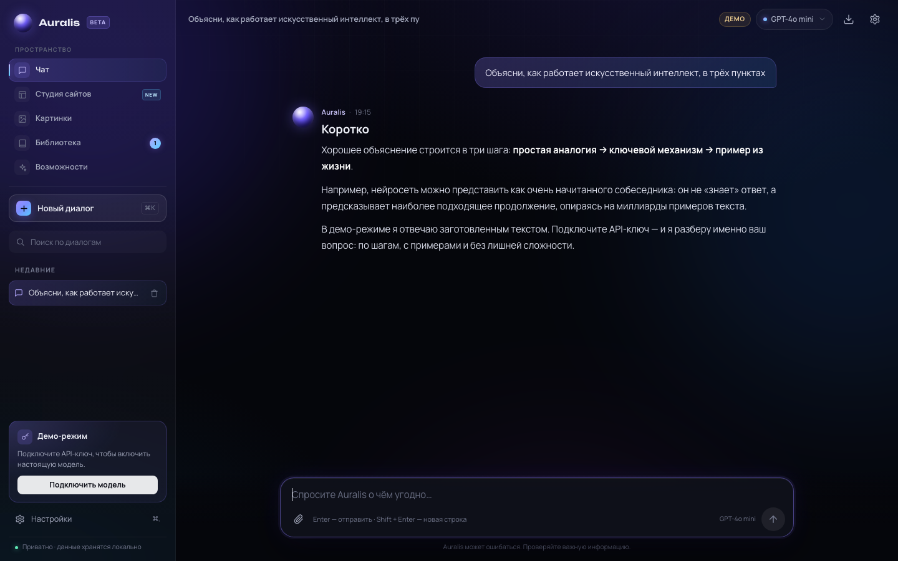

# Lumio

**Живая версия:** [lumio-emran7.vercel.app](https://lumio-emran7.vercel.app)

Премиальное AI-пространство в браузере: чат, студия сайтов и генератор изображений. Тёмный интерфейс, живые анимации, потоковые ответы, markdown и локальное хранение результатов.



## Быстрый старт

Нужен только [Node.js 18+](https://nodejs.org). Никаких зависимостей и сборки.

```bash
cd lumio
npm start
```

Откройте **http://127.0.0.1:4173**.

На macOS можно просто дважды кликнуть `start.command` — сервер запустится и браузер откроется сам.

## Пять пространств

| Раздел | Что делает |
| --- | --- |
| **Чат** | Диалоги с потоковыми ответами, markdown, кодом, таблицами и вложениями. |
| **Студия сайтов** | Собирает готовый сайт по описанию: превью в iframe, код, скачивание HTML и сохранение в библиотеку. |
| **Картинки** | Генерирует изображения по текстовому описанию: форматы 1:1, 16:9 и 9:16, лайтбокс, скачивание, сохранение. |
| **Библиотека** | Сайты, изображения и диалоги в одном личном архиве. |
| **Возможности** | Анимированная витрина продукта и быстрые переходы в нужный раздел. |

## Подключение модели

Чат и студия работают **сразу, без ключа**: по умолчанию выбран провайдер **Lumio Free** (бесплатные модели Nemotron через открытый OpenAI-совместимый шлюз). Если бесплатный канал занят, сервер автоматически пробует резервный бесплатный канал, а затем показывает аккуратный ответ без красной ошибки.

Чтобы подключить более сильную модель:

1. Нажмите шестерёнку (или кнопку «Выбрать модель»).
2. Выберите провайдера:
   - **Lumio Free** — без ключа, работает сразу;
   - **OpenRouter** — сотни моделей по одному ключу, есть бесплатные модели с суффиксом `:free`;
   - **Anthropic** — Claude напрямую;
   - **Gemini** — Google Gemini напрямую;
   - **OpenAI** — GPT-модели;
   - **Свой API** — любой OpenAI-совместимый сервер (Ollama, LM Studio, vLLM и т. д.).
3. Вставьте API-ключ, выберите модель и сохраните.

Ключ хранится в `localStorage` браузера и отправляется только локальному серверу, который пересылает его вашему провайдеру. На сервере ключ не сохраняется и не логируется.

Если ключ платного провайдера не указан или отклонён, запрос **не обрывается ошибкой**: Lumio автоматически переключается на бесплатную модель и добавляет в начало ответа короткую заметку. Это же правило действует для студии сайтов.

### Имя ассистента

В настройках есть поле **«Имя ассистента»**. По умолчанию — `Aura`; можно указать любое имя до 24 символов. Оно используется в приветствии, подписи сообщений, экспорте и системной инструкции.

> **Важно:** Lumio Free использует публичные бесплатные шлюзы. Не отправляйте через них пароли, ключи и другие секреты. Для чувствительных задач подключите собственный провайдер. У бесплатных моделей есть лимиты и периодические паузы — приложение показывает ожидание и автоматически пробует резервный канал.

### Claude и Gemini

Ключи нельзя «достать» из другого приложения или сервера — их нужно вставить вручную либо задать в окружении при запуске.

- **Claude:** создайте ключ в [console.anthropic.com](https://console.anthropic.com/settings/keys), вставьте его в настройках и выберите, например, `claude-sonnet-4-5`. Провайдер использует официальный Anthropic Messages API.
- **Gemini:** создайте ключ в [Google AI Studio](https://aistudio.google.com/app/apikey), вставьте его в настройках и выберите модель, например `gemini-2.5-pro` или `gemini-2.5-flash`. Провайдер использует OpenAI-совместимую точку Google.

Полезное:
- «Загрузить список» в настройках подтягивает доступные модели прямо от провайдера.
- Для Ollama укажите Base URL `http://localhost:11434/v1`, модель, например `llama3.2`, ключ можно оставить пустым.
- Модель можно ввести вручную, даже если её нет в списке.

## Переменные окружения

Ключ можно задать на сервере, тогда настройки в браузере не обязательны:

```bash
# Claude
ANTHROPIC_API_KEY=sk-ant-... npm start
# или
CLAUDE_API_KEY=sk-ant-... npm start

# Gemini
GEMINI_API_KEY=... npm start
# также поддерживаются GOOGLE_API_KEY и GOOGLE_GENERATIVE_AI_API_KEY

# Другие провайдеры
OPENROUTER_API_KEY=sk-or-v1-... npm start
OPENAI_API_KEY=sk-... npm start
AI_API_KEY=... npm start
```

| Переменная | По умолчанию | Описание |
| --- | --- | --- |
| `PORT` | `4173` | Порт сервера |
| `HOST` | `127.0.0.1` | Адрес, на котором слушает сервер |
| `ANTHROPIC_API_KEY` / `CLAUDE_API_KEY` | — | Ключ Claude |
| `GEMINI_API_KEY` / `GOOGLE_API_KEY` / `GOOGLE_GENERATIVE_AI_API_KEY` | — | Ключ Gemini |
| `OPENROUTER_API_KEY` | — | Ключ OpenRouter |
| `OPENAI_API_KEY` | — | Ключ OpenAI |
| `AI_API_KEY` | — | Ключ для своего API |

## Картинки

Генерация изображений работает **без API-ключей**:

- основной генератор — **Stable Horde** (Juggernaut XL, Dreamshaper и другие открытые модели);
- резервный — **Pollinations** (если сервис доступен);
- русский промпт автоматически переводится на английский перед генерацией (Google Translate, MyMemory или бесплатная текстовая модель);
- если оба внешних генератора заняты, Lumio собирает локальную векторную иллюстрацию по вашему описанию — без красной ошибки и без пустого экрана;
- готовые файлы сохраняются локально в `public/generated/` и не запрашиваются заново при открытии библиотеки.

У бесплатных генераторов есть лимиты и очереди. Обычно картинка появляется за 10–40 секунд; если внешние сервисы недоступны, показывается локальная иллюстрация с тем же промптом. Для стабильных фотореалистичных результатов можно подключить собственный платный генератор или использовать Stable Horde с аккаунтом.

> **Приватность:** Stable Horde — публичная сеть добровольных GPU-воркеров. Не отправляйте в промптах пароли, ключи и личные данные. Локальная иллюстрация создаётся на вашем компьютере и никуда не отправляется.

## Студия сайтов

Студия отправляет запрос выбранной модели и просит вернуть законченный HTML-документ. Если платная модель не ответила, запрос автоматически повторяется через **Lumio Free**; встроенный резервный шаблон используется только в последнюю очередь. Если модель оборвала последние закрывающие теги, Lumio аккуратно завершает `</style>`, `</script>`, `</body>` и `</html>` и сохраняет почти готовый сайт вместо замены шаблоном.

Резервный шаблон больше не один и тот же: он учитывает нишу, название проекта из промпта, палитру и один из трёх вариантов компоновки. Поэтому даже без сети студия не выдаёт одинаковую страницу на разные запросы.

Готовый сайт можно:

- посмотреть в превью на десктопе или телефоне;
- открыть в новой вкладке;
- скачать как `index.html`;
- сохранить в библиотеку и вернуться к нему позже.

Превью изолировано в iframe с sandbox. Сгенерированный HTML не получает доступ к ключам и данным приложения.

## Что ещё умеет

- Потоковые ответы с markdown, кодом, таблицами, цитатами и списками.
- Красивые code-блоки с копированием в один клик.
- Несколько диалогов, поиск по истории, удаление с отменой.
- Экспорт диалога в Markdown.
- Прикрепление текстовых файлов (до 300 КБ) прямо в сообщение.
- Выбор модели и провайдера, имя ассистента, температура, системная инструкция.
- Горячие клавиши: `⌘K` / `Ctrl K` — новый диалог, `⌘,` / `Ctrl ,` — настройки, `Esc` — закрыть.
- Адаптивность: десктоп, планшет, телефон.
- Всё хранится локально: история и библиотека в браузере, ключ в браузере.

## Структура

```
lumio/
├── server.js           # HTTP-сервер без зависимостей + прокси к LLM и картинкам
├── api/
│   └── [...path].js    # Vercel-функция: все /api/* запросы
├── public/
│   ├── index.html      # пять пространств и SVG-иконки
│   ├── styles.css      # дизайн-система, анимации, адаптивность
│   ├── landing.css     # стили лендинга
│   ├── app.js          # состояние, чаты, студия, картинки, библиотека
│   └── generated/      # локально сохранённые изображения
├── start.command       # запуск в один клик на macOS
├── vercel.json         # настройки деплоя на Vercel
└── README.md
```

## Безопасность

- Сервер слушает `127.0.0.1` и не доступен из сети по умолчанию.
- Markdown экранируется до разметки — HTML из ответа модели не может внедриться в страницу.
- CSP ограничивает источники скриптов, стилей и подключений, а `X-Frame-Options` запрещает внешним сайтам встраивать приложение.
- Превью сайтов работает в sandbox-iframe без доступа к родительскому окну.
- API-ключи не логируются.
- Ограничен размер запроса и длина истории.

**Важно:** если вы публикуете сайт в интернете и задаёте ключ через переменную окружения, добавьте авторизацию. Иначе любой посетитель сможет тратить ваши токены. Для публичного варианта безопаснее схема, где каждый пользователь вводит свой ключ.

## Деплой

### Vercel через GitHub

Репозиторий уже подготовлен для Vercel: статика лежит в `public/`, а все `/api/*` запросы обслуживает функция `api/[...path].js`, которая использует тот же `server.js`, что и локальный запуск. Проект `lumio` в Vercel уже подключён к GitHub-репозиторию, поэтому каждый пуш в `main` запускает новый деплой.

1. Запушьте изменения в ветку `main` репозитория на GitHub.
2. В Vercel откройте **Add New → Project** и импортируйте репозиторий (или переиспользуйте уже созданный проект).
3. Framework Preset — **Other**, Build Command оставьте пустой, Output Directory — `public`.
4. При необходимости добавьте переменные окружения (`ANTHROPIC_API_KEY`, `GEMINI_API_KEY`, `OPENROUTER_API_KEY`, `OPENAI_API_KEY`).
5. Нажмите **Deploy** — дальше Vercel будет пересобирать сайт при каждом пуше в `main`.

Готовые адреса: production-домен проекта и preview-ссылки для каждой ветки. Для собственного домена добавьте его в **Settings → Domains**.

> На Vercel файловая система только для чтения, поэтому сгенерированные картинки не сохраняются в `public/generated/`: сервер возвращает ссылку генератора или data URL. На обычном Node.js-хостинге файлы по-прежнему сохраняются локально.

### Любой Node.js-хостинг

Подойдёт VPS, Render, Railway, Fly.io.

1. Запускайте с `HOST=0.0.0.0` (или настройте reverse proxy).
2. Поставьте HTTPS.
3. Для публичного доступа добавьте вход/пароль или собственную авторизацию.
4. Не коммитьте ключи в репозиторий — используйте переменные окружения или ввод в браузере.

## Лицензия

Личный проект. Используйте и меняйте как хотите.

## Заметка о версии Lumio

- Проект переименован из Auralis в Lumio (ключи `localStorage` оставлены прежними, чтобы не потерять старые данные).
- Запасной сайт студии теперь строится по разбору промта: название, цвета, разделы и тема берутся из запроса, а не из одного шаблона.
- Если модель вернула сайт, который слабо повторяет описание, сервер делает ещё одну попытку и выбирает лучший вариант.
